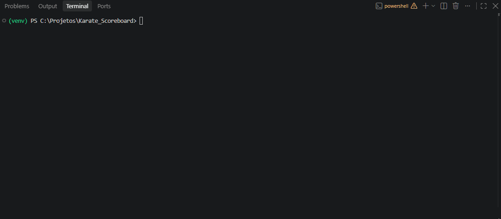
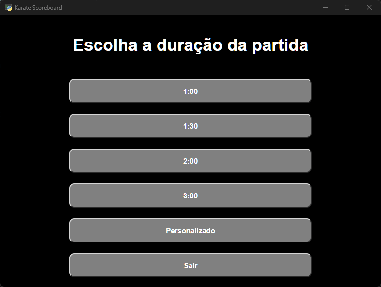

# 🥋 Karate_Scoreboard

Placar de karate para a categoria de kumite (WKF).

## ✨ Funcionalidades

- ⌚ Selecionar duração da luta
- 🎨 Selecionar orientação do placar (Vermelho na direita ou na esquerda)
- 🥊 Placar interativo:
  - Parar/resumir temporizador
  - Adicionar/remover pontos
  - Adicionar/remover senshu
  - Adicionar/remover penalidade
- 🏆 Seleção automática do vencedor

## 📸 Vídeos 

### Vídeo placar pelo terminal



### Vídeo placar pela aplicação



## 🚀 Como usar

### ⚠️ Instale as bibliotecas

  ```
  py -m venv venv 
  ```

  ```
  venv\Scripts\activate  
  ```

  ```
  pip install -r requirements.txt     
  ```

### 💻 Placar pelo terminal

1. No diretório raiz, execute:

  ```
  py -m backend.iniciar_placar_terminal
  ```


### 🌐 Placar pela aplicação

1. No diretório raiz, execute:

  ```
  py .\main.py   
  ``` 

2. Atalhos na execução do placar:
  - Clique esquerdo do mouse: Adicionar ponto/penalidade ou modificar senshu
  - Clique direito do mouse: Remover ponto/penalidade ou modificar senshu
  - Espaço: Pausar/resumir placar
  - Esc: Voltar à tela inicial

## 🛠️ Tecnologias Utilizadas

- Python
- JavaScript
- PyWebView
- html5 + css3

## 👩‍💻 Autora

Desenvolvido por **Camila Vidmontiene**, estudante de Ciência da Computação na [Universidade do Estado do Rio de Janeiro](https://www.uerj.br/).